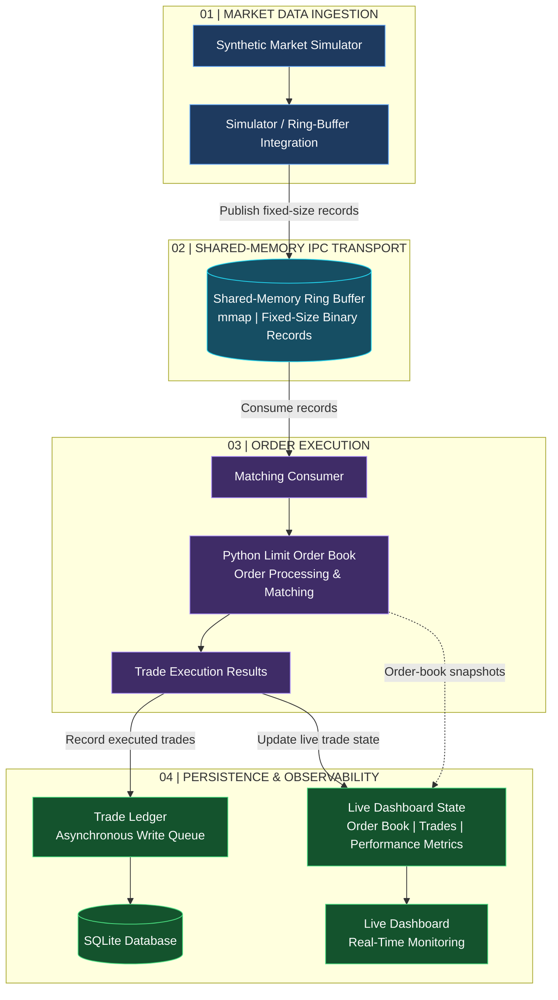

# ChronosMatch
**Live demo:** https://chronosmatch-dashboard-ig0n.onrender.com/ (free hosting: the first load can take 30 to 60 seconds while the server wakes up)

**A simulated low-latency trading engine exploring price-time-priority matching, shared-memory IPC, and market-data processing.**

ChronosMatch is an educational FinTech engineering project combining a Python limit order book, a synthetic market-data simulator, a shared-memory ring buffer, and a matching consumer. The project focuses on correctness, concurrency, reproducible testing, and careful latency measurement.

**Project status:** The Python matching engine, simulator-to-ring-buffer integration, IPC consumer, automated tests, and local benchmark scripts are implemented. An experimental Cython order-book prototype is available. The end-to-end benchmark reports ring-buffer write-to-read latency and producer-start-to-matching-completion latency, while matching-engine processing latency is measured separately. These metrics have different timing boundaries and must not be treated as interchangeable. The full-system 50-microsecond target has not been demonstrated.

## Key Features

- Limit order book with price-time-priority matching.
- Order validation, partial fills, and matching against resting orders.
- Synthetic market-tick generation.
- Fixed-record shared-memory IPC using `mmap` and `struct`.
- Producer/consumer integration with lifecycle and concurrency tests.
- Matching-engine, ring-buffer, and end-to-end pipeline benchmark scripts.
- Automated tests for order handling, matching, simulator behavior, IPC, integration, and failure cases.
- Experimental Cython order-book prototype and benchmark.


## System Architecture

ChronosMatch is organized into four logical layers: market-data ingestion, shared-memory transport, order execution, and persistence and observability.



### Architecture Overview

**Market Data Ingestion:** The synthetic market simulator generates market records, which are prepared by the simulator integration layer.

**SHARED-MEMORY IPC TRANSPORT:** Fixed-size binary records are transferred through a memory-mapped shared-memory ring buffer, avoiding unnecessary serialization overhead.

**Order Execution:** The matching consumer reads incoming records and passes them to the limit order book, where orders are processed and trades are generated.

**Persistence & Observability:** Executed trades are queued for asynchronous SQLite persistence. The live dashboard uses shared state to expose order-book snapshots, trade activity, latency, and throughput.

The benchmark scripts cover different timing boundaries. The matching-engine benchmark measures matching operations, while the end-to-end pipeline benchmark reports throughput, producer-start-to-consumer-read latency, matching-processing latency, and producer-start-to-matching-completion latency. These metrics describe different portions of the pipeline and must not be treated as interchangeable.

## Technology Stack

- Python
- Cython (experimental order-book prototype)
- `mmap` and `struct` for shared-memory records
- `asyncio` for simulator work
- `pytest` for automated tests
- GitHub Actions for Windows and Ubuntu CI checks

## Repository Structure

```text
ChronosMatch/
├── benchmarks/
│   ├── benchmark_engine.py
│   ├── benchmark_e2e.py
│   └── benchmark_ring_buffer.py
├── cython_test/
│   ├── cython_orderbook.pyx
│   ├── benchmark_cython_orderbook.py
│   ├── test_cython_orderbook.py
│   └── setup.py
├── docs/
│   ├── benchmark_results.md
│   ├── e2e_testing_plan.md
│   ├── ipc_ring_buffer_protocol.md
│   └── testing_plan.md
├── ipc/
│   ├── matching_consumer.py
│   └── ring_buffer.py
├── monitoring/
│   └── latency_monitor.py
├── simulator/
│   ├── market_simulator.py
│   └── ring_buffer_integration.py
├── src/chronosmatch/
│   ├── __init__.py
│   ├── matching_engine.py
│   └── order.py
├── tests/
├── .github/workflows/tests.yml
└── pyproject.toml
```

## Run Locally

From the repository root, create a virtual environment and install the test dependency.

### Windows PowerShell

```powershell
python -m venv .venv
.\.venv\Scripts\python.exe -m pip install --upgrade pip
.\.venv\Scripts\python.exe -m pip install pytest
```

Run the test suite:

```powershell
.\.venv\Scripts\python.exe -m pytest -q
```

Run the matching-engine microbenchmark:

```powershell
$env:PYTHONPATH = "$(Get-Location)\src;$(Get-Location)"
.\.venv\Scripts\python.exe benchmarks\benchmark_engine.py
```

Run the end-to-end pipeline benchmark with a reproducible synthetic workload:

```powershell
$env:PYTHONPATH = "$(Get-Location)\src;$(Get-Location)"
.\.venv\Scripts\python.exe benchmarks\benchmark_e2e.py --count 10000 --capacity 2048 --poll-interval-ms 0.1 --seed 7
```

Check a script's help output if its command-line options change.

## Testing and Quality Evidence

- The test suite covers the matching engine, order validation, simulator, ring buffer, consumer integration, and end-to-end behavior.
- GitHub Actions runs the repository test workflow on Windows and Ubuntu.
- Report test counts and pass/fail results from the actual run being cited; historical counts are not a substitute for a fresh run.
- See [`docs/testing_plan.md`](docs/testing_plan.md) and [`docs/e2e_testing_plan.md`](docs/e2e_testing_plan.md) for testing scope and procedures.
- See [`docs/ipc_ring_buffer_protocol.md`](docs/ipc_ring_buffer_protocol.md) for the IPC record contract.

## Performance Measurement

See [`docs/benchmark_results.md`](docs/benchmark_results.md) for recorded matching-engine and pipeline results.

Keep these metrics distinct:

- **Matching-engine latency:** Time spent executing the measured matching-engine operation for the documented workload.
- **Producer-start-to-consumer-read latency:** Time from the defined producer start to the consumer reading the corresponding tick.
- **Matching-processing latency:** Time spent processing an individual record through the matching-engine operation.
- **Producer-start-to-matching-completion latency:** Time from the defined producer start until matching processing for the corresponding tick is complete.
- **Throughput:** Processed ticks per second over the benchmark's reported elapsed interval.

These measurements cover different stages and are not interchangeable. Results use synthetic data on a local development machine and can vary by workload and environment. The 50-microsecond full-system target remains an engineering objective, not a validated result.

## Current Team

- **Suraj Baliar Singh — Team Lead / Matching Engine, IPC Adapter, and Benchmarking:** Coordinates work distribution and integration; develops matching-engine and adapter functionality; records benchmark and test evidence.
- **Avinash Rajagore — Shared-memory IPC / Ring Buffer:** Focuses on ring-buffer reliability, producer/consumer behavior, concurrency, and lifecycle handling.
- **Samrudhi Gowda — Testing / Documentation:** Focuses on test coverage, testing plans, baseline evidence, and documentation reviews.

Team contributions should be verified from the relevant commits and pull requests. Active members work on dedicated branches, with changes reviewed and merged into `main`.

## Roadmap

- [x] Implement the Python order model and price-time-priority matching engine.
- [x] Add automated matching-engine and order-validation tests.
- [x] Implement the shared-memory ring buffer and IPC consumer path.
- [x] Integrate simulator-generated ticks with the ring-buffer and matching path.
- [x] Add ring-buffer reliability, concurrency, and lifecycle tests.
- [x] Record matching-engine and pipeline benchmark results with measurement limitations.
- [x] Document test procedures and the IPC protocol.
- [ ] Evaluate and integrate the experimental Cython order-book prototype where appropriate.
- [x] Add a per-tick producer-start-to-matching-completion latency measurement.
- [ ] Continue investigating throughput and tail-latency variation.
- [ ] Complete and demonstrate any remaining dashboard/demo requirements.

## Safety and Scope

ChronosMatch uses simulated orders and market data for educational and performance-engineering purposes. It is not connected to a live exchange and is not intended to execute real financial trades.
